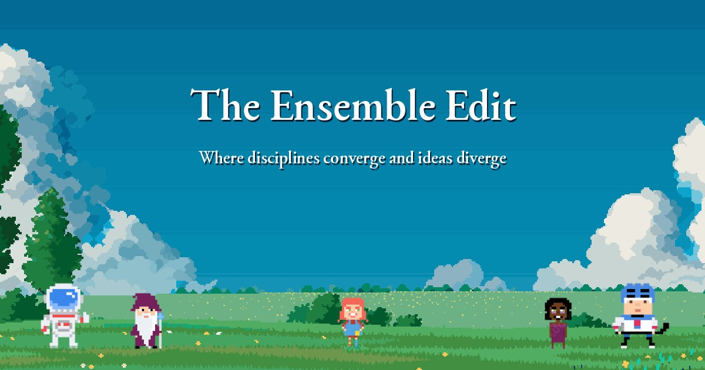

# The Ensemble Edit

This repo builds and publishes [the-ensemble-edit.com](https://the-ensemble-edit.com), including every post, author page and agenda event.

## Background

The Ensemble Edit is a postgrad-led blog at UCD about research life, AI and climate. Anyone who wants to write for it is welcome.

## Tech stack

- [Astro 5](https://astro.build) static site with a few serverless API routes, deployed on Vercel
- Tailwind CSS v4 and TypeScript; posts are Markdown or MDX in Astro content collections
- Resend for the submission form emails, the subscribe form and newsletter drafts
- Upstash Redis for page views, the homepage pinboard and the poster poll
- Giscus (GitHub Discussions) for comments, Open-Meteo for the footer weather

## Getting started

You need Node.js 20 or 22+ and Yarn 1.

```bash
yarn install
yarn dev       # http://localhost:4321
yarn build     # astro check, then the production build
yarn preview   # serve the build locally
```

The site runs and builds with no environment variables. Each of these switches on one feature; copy `.env.example` to `.env` locally, or set them in the Vercel project settings for the live site.

| Variables | What they enable |
| --- | --- |
| `RESEND_API_KEY`, `SUBMIT_TO_EMAIL` | The submission form emailing the editor |
| `RESEND_FULL_API_KEY`, `RESEND_AUDIENCE_ID` | The subscribe form, the form's "email me" box and the newsletter scripts |
| `NEWSLETTER_FROM`, `NEWSLETTER_REPLY_TO`, `SITE_URL`, `RESEND_SEGMENT_ID` | Sender, reply-to and links for the form emails and newsletter script |
| `UPSTASH_REDIS_REST_URL`, `UPSTASH_REDIS_REST_TOKEN` | View counts, the pinboard and the poll (Vercel's `KV_REST_API_URL` and `KV_REST_API_TOKEN` also work) |
| `GITHUB_TOKEN` | Converge/diverge reaction counts on posts |

Sending a new-post email is covered in [docs/email-notifications.md](docs/email-notifications.md).

## Project structure

```text
src/
  content/blog/       posts (.md or .mdx)
  content/authors/    author profiles (.json)
  content/events/     agenda events (.md)
  assets/blogimages/  cover images, one folder per post slug
  pages/              routes; pages/api/ holds the serverless endpoints
  components/, layouts/, styles/
  consts.ts           site title, topics and nav links
public/               avatars, banners, icons, parallax layers, email covers
design-assets/        source pixel art (avatar set, banners, parallax)
scripts/              newsletter and subscriber scripts
templates/            post and author starters, newsletter email HTML
docs/                 maintainer notes
```

## Content and data

- **Posts** live in `src/content/blog/<slug>.md`, with the cover at `src/assets/blogimages/<slug>/cover.jpg` (or `.png`).
- **Authors** live in `src/content/authors/<id>.json`, with the avatar at `public/avatars/<id>.png`.
- **Events** for the agenda page live in `src/content/events/` ([docs/calendar-events.md](docs/calendar-events.md)).
- **Topics**: each post has a `track` field (`phd-tips`, `discussion`, `events` or `research`). Readers see these as Topics at [/tracks/](https://the-ensemble-edit.com/tracks/).
- Submissions arrive by email and only enter the repo once published. View counts, pinboard notes and poll votes are stored in Upstash, comments in GitHub Discussions, and subscribers in Resend.
- `.env`, `dist/`, `.vercel/`, `.astro/` and `node_modules/` are gitignored.

## Submitting a post

Writers use the form at [the-ensemble-edit.com/submit](https://the-ensemble-edit.com/submit/), and the [Instructions for Authors](https://the-ensemble-edit.com/blog/instructions-for-authors/) explain what happens next. No Git or GitHub needed. Maintainer steps are in [CONTRIBUTING.md](CONTRIBUTING.md).

## Licence

MIT, see [LICENSE](LICENSE). The copyright line there is Yash Jawale's, from the Saral Astro theme the site was built on.
